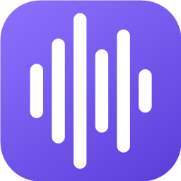
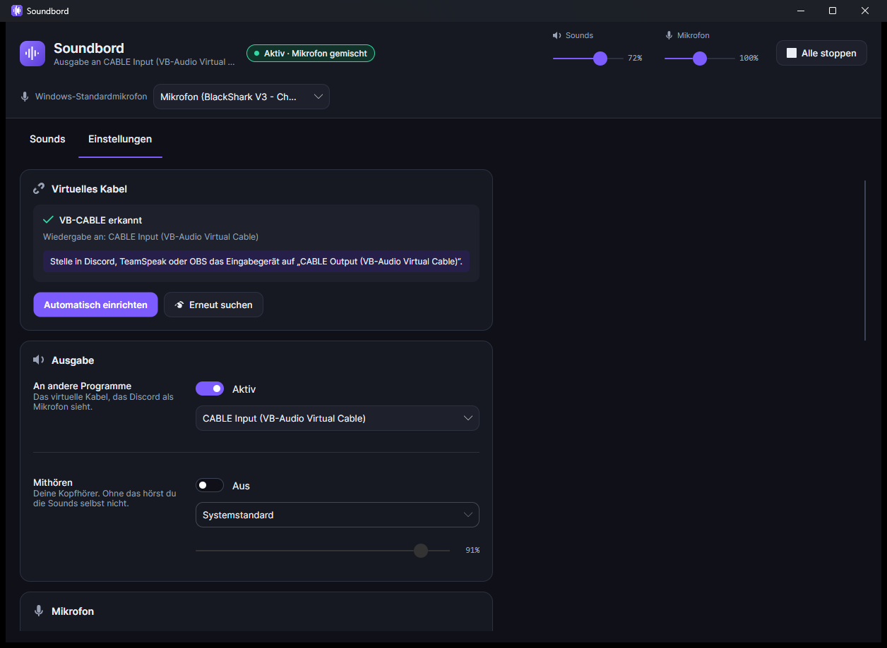
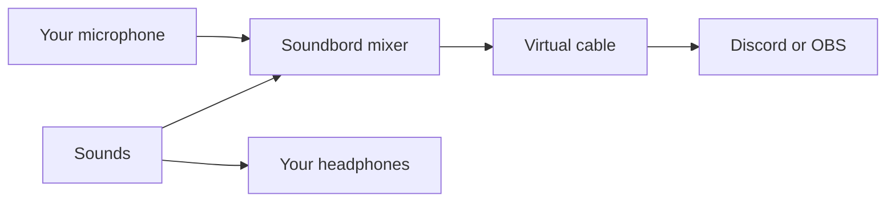

<div align="center">



# Soundbord

**A soundboard for Windows. It plays sounds into Discord, TeamSpeak, OBS or games as if they came from your microphone, and your real microphone keeps working.**


[](https://github.com/businessbaum/Soundbord/releases/latest)



<sub>The app is in German. This is the settings page after the virtual cable was found.</sub>

</div>

## Download

You can download Soundbord.exe from the [latest release](https://github.com/businessbaum/Soundbord/releases/latest). It is a single file and needs no installation. The file is not signed, so Windows may show a warning the first time. Click "More info" and then "Run anyway".

## Why I made it

Windows has no way for one program to put sound into another program's microphone. The usual trick is a virtual audio cable: a driver that acts like a speaker and a microphone at the same time. Most soundboards then also need a mixer program like VoiceMeeter. I wanted something simpler, so Soundbord mixes your microphone and the sounds itself. You only need the free cable.



## Setup

1. Install [VB-CABLE](https://vb-audio.com/Cable/) and restart your PC.
2. Open Soundbord, go to the settings tab and click the button for automatic setup.
3. In Discord, TeamSpeak or OBS, choose "CABLE Output" as your microphone.

## Features

- Sounds in folders that you can sort with drag and drop
- Global hotkeys that also work while a game is open, plus one key that stops everything
- Separate volume for sounds and for your microphone
- You hear the sounds on your headphones, the others hear them through the cable
- You can switch the Windows default microphone from inside the app
- You can send the sound of another app, like Spotify or a browser, into the cable
- Supports wav, mp3, ogg, flac, m4a, aac, wma and aiff

## Things I learned

- **Hotkeys need their own thread.** Windows removes a keyboard hook if it takes longer than about 300 ms, so key presses are handled in a separate queue.
- **Volume sliders should work in decibels.** People hear loudness in a logarithmic way. A normal slider does almost nothing for most of its range, so mine is linear in decibels.
- **The microphone delay can grow over time.** The microphone and the output run on different clocks. If the delay gets too big, Soundbord drops only the extra part.
- **Capturing one app's sound is possible.** Windows 10 and 11 can record the sound of a single program. NAudio does not support it, so I added that part by hand. I tested it with a 440 Hz test tone and checked that the tone only showed up where it should.

## Build it yourself

```powershell
dotnet run --project src\Soundbord
dotnet publish src\Soundbord -p:PublishProfile=win-x64
```

The first command starts the app. The second one builds the single file version.

## Limits

- If a game runs as administrator, Soundbord also has to run as administrator, or the hotkeys won't work in that game.
- With push to talk, the others only hear the sounds while you hold your talk key.
- Opus files are not supported.

## Notes

Soundbord later became the soundboard tool inside [WinTo](https://github.com/businessbaum/WinTo).

## License

MIT, see [LICENSE](LICENSE).
